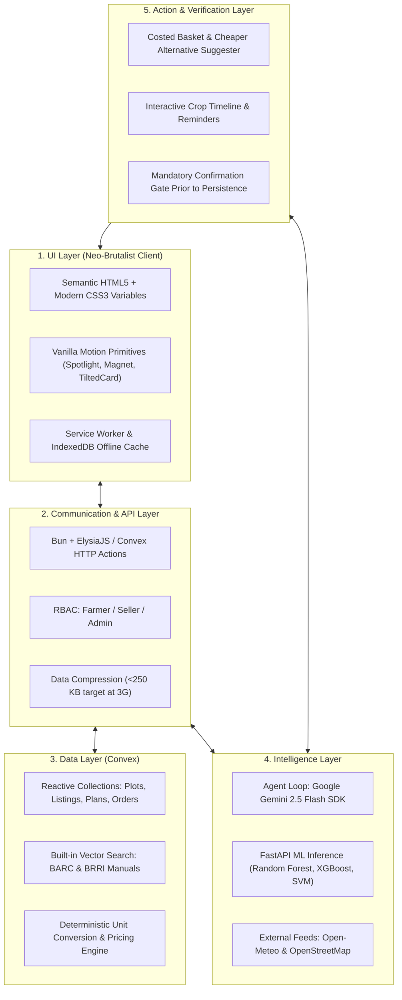

# Agrisense 🌾
### An Agentic AI Platform for Crop Planning and Fair-Price Agricultural Trade
**Course**: SE-331 Software Engineering Design Capstone Project  
**Institution**: Daffodil International University (DIU), Department of Software Engineering  
**Group**: 17 | **Supervisor**: Md. Rashedul Alam  

---

## 📖 Executive Summary
**Agrisense** is an Agentic AI platform engineered for smallholder farming households in Bangladesh. Small farmers face four compounding bottlenecks when planning an agricultural season:
1. **Uncomparable Input Prices**: Pesticides, fertilizers, and seeds are sold across fragmented units (250g, 1kg, 100ml, 1L, loose scoops) with opaque delivery charges.
2. **Complex Unit Conversions**: Official guidance (BARC Fertilizer Recommendation Guide, BRRI manuals) provides rates per hectare, while rural plots are measured in local units (Bigha, Katha, Decimal, Acre).
3. **Fragmented & Hallucinatory Advice**: Generic chatbots hallucinate dosages without verifiable agricultural sources, while existing mobile apps only offer isolated diagnostic photos.
4. **Poor Rural Connectivity**: Traditional heavy web applications fail under volatile 2G/3G conditions in remote upazilas.

Agrisense resolves this through an **Agentic AI Orchestrator (Google Gemini 2.5 Flash)** backed by a **FastAPI Machine Learning Microservice**, a reactive **Convex Database with Vector Search**, and a high-contrast **Neo-Brutalist Web Client** engineered for zero third-party build lock-in and offline resilience.

---

## 🏛️ System Architecture: The 5-Layer Design



---

## 🛠️ Technology Stack Breakdown

| Layer | Technology | Key Responsibility |
| :--- | :--- | :--- |
| **Database & Vector Index** | **Convex** | Real-time reactive document storage, serverless mutations, and built-in vector search for agricultural manuals. |
| **Backend & Routing** | **Bun + ElysiaJS / Convex Actions** | High-performance TypeScript API runtime, agent tool execution, JWT authentication. |
| **Agentic AI** | **Google Gemini 2.5 Flash** | Intent classification, parameter gathering, and approved tool calling via Google Gen AI SDK. |
| **ML Inference Service** | **Python (FastAPI)** | Microservice evaluating 4 models for crop suitability and price anomaly detection. |
| **ML Frameworks** | **scikit-learn, XGBoost, pandas** | 4-algorithm comparison (Random Forest, XGBoost, Logistic/Linear Regression, SVM). |
| **Frontend UI** | **Semantic HTML5, CSS3, Vanilla JS** | Zero third-party build lock-in, pure Black & White Neo-Brutalism, <250 KB compressed. |
| **Micro-Interactions** | **React Bits & Motion Primitives** | SpotlightCard, Magnet Buttons, TiltedCard, DecryptedText, ClickSpark, AnimatedCounter. |
| **External Integrations** | **Open-Meteo & OpenStreetMap** | Real-time 7-day weather forecasts and Upazila geocoding. |

---

## 👥 Team Roster, Git Identifiers & Workspaces

Every team member has a dedicated workspace containing their task breakdown and AI assistant instructions:

| Contributor | Student ID | GitHub Handle | Role | Workspace Link |
| :--- | :--- | :--- | :--- | :--- |
| **Imranul Islam Sihab** | 232-35-733 | [`@imransihab0`](https://github.com/imransihab0) | **Team Lead**: Backend API, Agentic AI, Convex DB, Pricing Arithmetic, Frontend Design Spec | [`team/imransihab0/`](team/imransihab0/) |
| **Imtiaz Ibna Kamal** | 232-35-680 | [`@imtiazdeepto`](https://github.com/imtiazdeepto) | **ML Engineer**: Tabular Datasets, 4-Model Comparative Analysis, FastAPI Inference Service | [`team/imtiazdeepto/`](team/imtiazdeepto/) |
| **Sharmarke Abdi Abdullahi** | 232-35-808 | [`@zharmo`](https://github.com/zharmo) | **Frontend & Offline Engineer**: Neo-Brutalist UI, Motion Primitives, Offline Service Worker | [`team/zharmo/`](team/zharmo/) |

---

## 🎨 Neo-Brutalist Frontend Design Specifications
Full specification available in [`docs/FRONTEND_DESIGN.md`](docs/FRONTEND_DESIGN.md).

- **Pure B&W Theme**: `#FFFFFF` background with inverted `#0A0A0A` dark mode.
- **Halftone Dotted Canvas**: 24px radial-gradient dot pattern.
- **Chunky Outlines & Hard Shadows**: 2.5px solid borders, `3px 3px 0px` and `5px 5px 0px` zero-blur drop shadows.
- **Typography**: `Space Grotesk` (headings), `Plus Jakarta Sans` (body), `Space Mono` (tags & units).
- **Illustrations & Micro-Interactions**: Pablo Stanley's Open Peeps avatars, Vijay Verma's 3dicons, SpotlightCard cursor glow, Magnet buttons, TiltedCard 3D perspective, DecryptedText reveal, and ClickSpark bursts.

---

## 🔒 Four Architectural Invariants
1. **Zero LLM Arithmetic**: All unit conversions ($1\text{ bigha} = 0.1338\text{ ha}$) and common-unit calculations ($\text{Price/kg} = (\text{Price} + \text{Delivery}) / \text{Pack Size}$) run in unit-tested backend code.
2. **Approved Server-Side Tools Only**: Gemini is constrained to a whitelisted set of server functions.
3. **Traceable Ground Truth**: Every agronomic claim links directly to its source publication (BARC, BRRI, DAE).
4. **Mandatory User Confirmation**: No plan or procurement order request is saved without explicit user confirmation.

---

## 🚀 Repository Quickstart

### 1. Clone & Fetch Updates
```bash
git clone https://github.com/imransihab0/capstone_2026.git
cd capstone_2026
git checkout -b feat/<your-assigned-feature>
```

### 2. Configure Environment
Copy `.env.example` to `.env.local` and add credentials:
```bash
cp .env.example .env.local
```

### 3. Run Convex Backend
```bash
npx convex dev
```

### 4. Run ML Inference Microservice
```bash
cd services/ml-inference
python3 -m venv venv
source venv/bin/activate
pip install -r requirements.txt
uvicorn app.main:app --reload --port 8000
```
