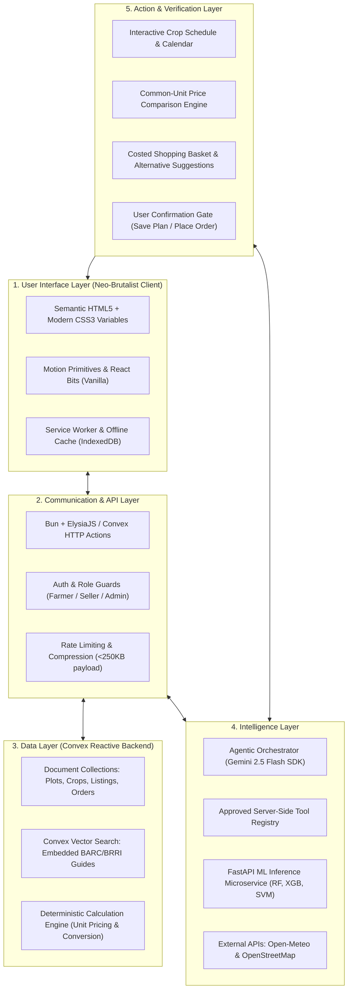

# Agrisense: System Architecture
**Capstone Project**: SE-331 Software Engineering Design  
**Platform**: Agrisense — Agentic AI Platform for Crop Planning & Fair-Price Agricultural Trade  

---

## 1. System Overview & The 5-Layer Model

Agrisense separates concerns into 5 distinct architectural layers to ensure fault tolerance, offline resilience, and mathematical integrity.

---

## 2. Detailed Layer Specifications

### Layer 1: User Interface Layer
- **Neo-Brutalist Styling**: High contrast `#0A0A0A` and `#FFFFFF` with 2.5px solid borders, halftone dotted backgrounds, and hard drop shadows (`3px 3px 0px`, `5px 5px 0px`).
- **Offline First**: Service Worker intercepts network requests; saved crop plans, shopping lists, and past weather alerts are accessible with zero connection.
- **Timestamping**: Displays clear `Last Updated: [Time]` badges across all pricing and weather data to prevent stale decisions.

### Layer 2: Communication Layer
- **Ultra-lean Payloads**: Structured JSON responses optimized for 3G mobile data speeds in rural Bangladesh.
- **Strict Role-Based Access Control**:
  - `farmer`: Create/edit owned plots, generate plans, compare prices, submit order requests.
  - `seller`: Register shop, publish/update inventory listings, view received order requests.
  - `admin`: Audit price warnings, verify sellers, inspect agent telemetry logs.

### Layer 3: Data Layer (Convex)
- **Reactive Queries**: Real-time updates when seller inventory changes.
- **Embedded Document Search**: Built-in vector index querying chunks of official manuals (BARC Fertilizer Recommendation Guide, BRRI Rice Manual).
- **Arithmetic Invariance**: Land area conversion ($1\text{ bigha} = 0.3306\text{ acre} \approx 0.1338\text{ ha}$) and common unit price calculation:
  $$\text{Effective Price per Unit} = \frac{\text{Listed Pack Price} + \text{Delivery Fee}}{\text{Pack Size in Base Units (kg or L)}}$$

### Layer 4: Intelligence Layer
- **Gemini 2.5 Flash Agent**: Functions in an iterative tool-use loop:
  1. Parse farmer goal (e.g., "Grow Boro Rice on 1 bigha in Tangail with Tk 8,000 budget").
  2. Inspect plot record; query farmer for missing parameters if required.
  3. Invoke `search_farming_guidance`, `get_weather_forecast`, and `predict_crop_suitability`.
  4. Invoke `calculate_plot_quantities` and `fetch_normalized_listings`.
  5. Assemble costed basket and evaluate budget constraints.
- **FastAPI Inference Microservice**:
  - Handles `/predict/crop-suitability` and `/predict/price-status`.
  - Runs team-trained Scikit-learn and XGBoost pipelines.

### Layer 5: Action & Verification Layer
- **Mandatory Confirmation**: No seasonal plan or order request is written to the database without explicit farmer confirmation.
- **Source Badging**: Every recommendation block displays an interactive badge:
  - `[SOURCE: BARC Guide 2024, Sec. 4.2]` (Official Document)
  - `[MODEL: Random Forest v1.2, 94.2% Acc]` (ML Estimation)
  - `[MARKETPLACE: Verified Seller]` (Live Listing)
